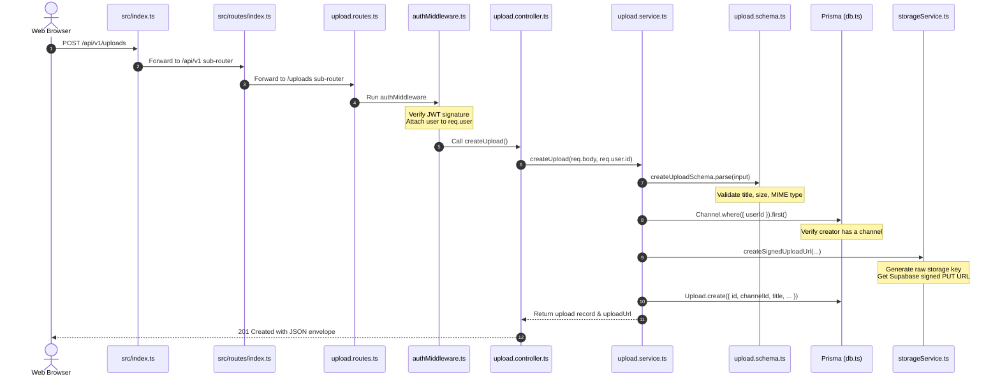

# Chapter 2: Backend Architecture & Request Lifecycle

This guide explains how the Vion backend works from the moment a network packet reaches the server until an HTTP response is sent back to the client.

If you have built basic Express servers where routes, database queries, and validation were crammed into a single `server.js` file, this document explains **why enterprise backends separate concerns**, **how layers communicate**, and **how Vion implements this cleanly on Bun and Express 5**.

---

## 1. The Technology Foundation: Bun & Express 5

### What is Bun in this project?
Vion uses **Bun** (`bun --watch ./src/index.ts`) as its JavaScript/TypeScript runtime instead of traditional Node.js + `ts-node`.
- **Native TypeScript**: Bun executes `.ts` files directly without an external compilation step (`tsc`) or transpiler (`esbuild`/`ts-node`).
- **High Performance**: Bun has an ultra-fast startup time, native `.env` loading, and high-throughput I/O operations.
- **Fast Package Management**: Bun installs dependencies in seconds using a binary lockfile (`bun.lockb`).

### What is Express 5?
Vion runs on **Express v5.2.1** (`"express": "^5.2.1"`). 
Express is a minimalist web framework providing:
1. An HTTP server pipeline.
2. Route pattern matching (e.g. `/api/v1/uploads/:uploadId`).
3. Middleware chaining (passing requests through sequential functions).
4. Native support for rejected promises in route handlers (unlike Express 4, which could hang if an async error wasn't caught).

---

## 2. Server Entry Point: `src/index.ts`

The application boots from [`backend/src/index.ts`](file:///f:/VS%20CODE/Codes/Projects/Vion%20youtube/backend/src/index.ts). Let's look at the initialization sequence:

```typescript
// backend/src/index.ts (Simplified execution flow)
export const app = express();

// 1. Global Ingestion Middleware
app.use(express.json());       // Parses incoming JSON request bodies into req.body
app.use(cookieParser());       // Parses Cookie headers into req.cookies

// 2. Cross-Origin Resource Sharing (CORS)
app.use(cors({ origin: allowedOrigins, credentials: true }));

// 3. API Versioning Router
app.use("/api/v1", router);

// 4. Centralized Error Handling Middleware (MUST BE LAST)
app.use(errorHandler);

// 5. Port Listening & DB Connection
export const server = app.listen(PORT, async () => {
  await db.connect();
  console.log(`[Vion Server] Connected to Neon PostgreSQL database`);
});
```

### Why Graceful Shutdown Matters
In [`backend/src/index.ts#L56-L86`](file:///f:/VS%20CODE/Codes/Projects/Vion%20youtube/backend/src/index.ts#L56-L86), Vion captures `SIGINT` (Ctrl+C) and `SIGTERM` (Docker container stop signals):
```typescript
process.on("SIGINT", () => gracefulShutdown("SIGINT"));
process.on("SIGTERM", () => gracefulShutdown("SIGTERM"));
```
When a shutdown signal occurs:
1. `server.close()` stops accepting *new* HTTP connections while allowing existing requests to finish processing.
2. The database connection (`db.disconnect()`) is cleanly closed, releasing Neon pooled connections.
3. A 10-second timeout ensures the process terminates even if a socket hangs.

---

## 3. Separation of Concerns: The Layered Pattern

Instead of putting all application logic in route files, Vion strictly separates concerns into five layers:

```
┌────────────────────────────────────────────────────────┐
│                      Client / Web                      │
└───────────────────────────┬────────────────────────────┘
                            │ HTTP Request
                            ▼
┌────────────────────────────────────────────────────────┐
│ 1. Routing Layer (routes/index.ts & *.routes.ts)        │
│    - Maps HTTP method + URL to controller              │
│    - Mounts route-level middleware (auth)              │
└───────────────────────────┬────────────────────────────┘
                            │
                            ▼
┌────────────────────────────────────────────────────────┐
│ 2. Middleware Layer (authMiddleware.ts)                │
│    - Inspects tokens / cookies                         │
│    - Rejects unauthorized requests early (401)         │
│    - Attaches decoded user identity to req.user        │
└───────────────────────────┬────────────────────────────┘
                            │
                            ▼
┌────────────────────────────────────────────────────────┐
│ 3. Controller Layer (*.controller.ts)                  │
│    - Extracts req.body, req.params, req.query          │
│    - Calls the service function                        │
│    - Formats the HTTP response (status code, JSON)     │
└───────────────────────────┬────────────────────────────┘
                            │
                            ▼
┌────────────────────────────────────────────────────────┐
│ 4. Service Layer (*.service.ts)                        │
│    - Validates data shapes using Zod schemas           │
│    - Executes business logic & checks ownership        │
│    - Calls external services (Storage, Queue, etc.)   │
│    - Performs database CRUD operations via Prisma      │
└───────────────────────────┬────────────────────────────┘
                            │
                            ▼
┌────────────────────────────────────────────────────────┐
│ 5. Data Access Layer (src/prisma/db.ts)                │
│    - Interacts with PostgreSQL over TLS                │
└────────────────────────────────────────────────────────┘
```

### Why this architecture?
| Layer | Responsibility | What it NEVER does |
| :--- | :--- | :--- |
| **Routes** | Define URLs and bind middleware. | Contain business logic or SQL queries. |
| **Middleware** | Intercept requests (e.g. auth, rate-limiting). | Send final business responses. |
| **Controllers** | Handle HTTP transport (`req`, `res`). | Perform SQL queries or interact with external storage directly. |
| **Services** | Core business logic, validation, transactions. | Know about Express `req` or `res` objects. |
| **Prisma/DB** | Data persistence and type-safe query execution. | Enforce HTTP business rules. |

Because services never touch Express `req` or `res`, **services can be unit tested without mocking HTTP servers**, and can even be reused inside background workers or CLI scripts!

---

## 4. API Versioning & Route Hierarchy

All Vion API routes are prefixed with `/api/v1` in [`backend/src/index.ts#L42`](file:///f:/VS%20CODE/Codes/Projects/Vion%20youtube/backend/src/index.ts#L42):
```typescript
app.use("/api/v1", router);
```

The top-level router [`backend/src/routes/index.ts`](file:///f:/VS%20CODE/Codes/Projects/Vion%20youtube/backend/src/routes/index.ts) mounts feature modules:

```typescript
// src/routes/index.ts
router.use("/auth", authRouter);
router.use("/users", authMiddleware, userRouter);
router.use("/channels", channelRouter);
router.use("/uploads", uploadRouter);
router.use("/videos", videoRouter);
router.use("/comments", commentRouter);
router.use("/history", watchHistoryRouter);
router.use("/feed", feedRouter);
router.use("/search", searchRouter);
router.use("/categories", categoryRouter);
router.use("/notifications", authMiddleware, notificationRouter);
router.use("/admin", authMiddleware, adminRouter);
router.use("/health", healthRouter);
```

Notice two patterns:
1. **Module-level Guarding**: `router.use("/users", authMiddleware, userRouter)` automatically requires authentication for *all* user endpoints.
2. **Route-level Guarding**: Endpoints like `/channels` or `/uploads` mount sub-routers where some endpoints are public (e.g. viewing a public channel) and others are private (e.g. uploading a video).

---

## 5. Authentication & Authorization

Authentication is handled by [`backend/src/middlewares/authMiddleware.ts`](file:///f:/VS%20CODE/Codes/Projects/Vion%20youtube/backend/src/middlewares/authMiddleware.ts).

### Dual-Token Extraction Strategy
Vion supports both browser web clients (which send HTTP-only cookies) and mobile or external API clients (which send `Authorization: Bearer <token>` headers):

```typescript
function extractToken(req: Request): string | undefined {
  // 1. Check HTTP-only cookie first (browser client)
  if (req.cookies?.token) {
    return req.cookies.token;
  }
  // 2. Check Authorization Bearer header (mobile / API client)
  const authHeader = req.headers.authorization;
  if (authHeader && authHeader.startsWith("Bearer ")) {
    return authHeader.substring(7);
  }
  return undefined;
}
```

### The Two Auth Middlewares

1. **`authMiddleware` (Strict Authentication)**:
   - If no token is provided: throws `AppError("Authentication token missing.", 401)`.
   - Verifies token signature using `jwt.verify(token, JWT_SECRET)`.
   - If valid, attaches decoded user info (`{ id, email }`) to `req.user` and calls `next()`.
   - If expired or tampered with: throws `AppError("Invalid or expired authentication token.", 401)`.

2. **`optionalAuthMiddleware` (Contextual Authentication)**:
   - Used on endpoints that can be viewed by anyone, but offer enriched features for logged-in users (e.g. `GET /api/v1/videos/:id` needs to know if the viewer has already liked the video, but anonymous viewers can still watch it).
   - If no token exists, it silently calls `next()` without throwing.
   - If a valid token exists, it populates `req.user`.

---

## 6. The Async Error Handling Pattern

### The Problem in Node.js / Express
In JavaScript, an unhandled rejection in an asynchronous function can crash the process or leave the HTTP connection hanging indefinitely until timeout.

### The Solution: `asyncHandler`
Vion wraps asynchronous route handlers with [`backend/src/utils/asyncHandler.ts`](file:///f:/VS%20CODE/Codes/Projects/Vion%20youtube/backend/src/utils/asyncHandler.ts):

```typescript
export const asyncHandler = (fn: Function) => {
  return (req: Request, res: Response, next: NextFunction) => {
    Promise.resolve(fn(req, res, next)).catch(next);
  };
};
```
Whenever an asynchronous function throws an exception or rejects a Promise, `asyncHandler` intercepts it and passes it to Express's `next(error)` function, automatically forwarding it to the centralized error middleware.

---

## 7. Centralized Error Responses: `errorHandler.ts`

All uncaught errors converge at [`backend/src/middlewares/errorHandler.ts`](file:///f:/VS%20CODE/Codes/Projects/Vion%20youtube/backend/src/middlewares/errorHandler.ts).

Vion guarantees that clients receive a **predictable, standardized JSON envelope** regardless of whether an error was caused by invalid input, bad authentication, or an internal server bug:

```typescript
// Central error handling logic
export function errorHandler(error: unknown, req: Request, res: Response, next: NextFunction) {
  // Case 1: Zod schema validation failed
  if (error instanceof ZodError) {
    const message = error.issues.map((i) => `${i.path.join(".") || "field"}: ${i.message}`).join(", ");
    return res.status(400).json({
      success: false,
      error: {
        code: "VALIDATION_ERROR",
        message: message || "Validation failed",
        details: error.issues,
      },
    });
  }

  // Case 2: Intentional application error (AppError)
  if (error instanceof AppError) {
    return res.status(error.statusCode).json({
      success: false,
      error: {
        code: error.code,
        message: error.message,
      },
    });
  }

  // Case 3: Standard JavaScript Error
  if (error instanceof Error) {
    return res.status(400).json({
      success: false,
      error: {
        code: "BAD_REQUEST",
        message: error.message,
      },
    });
  }

  // Case 4: Unhandled unexpected bug
  return res.status(500).json({
    success: false,
    error: {
      code: "INTERNAL_SERVER_ERROR",
      message: "Internal Server Error.",
    },
  });
}
```

### The Custom `AppError` Class
Defined in [`backend/src/utils/AppError.ts`](file:///f:/VS%20CODE/Codes/Projects/Vion%20youtube/backend/src/utils/AppError.ts), this class allows developers to throw errors with specific HTTP status codes and machine-readable error codes:
```typescript
throw new AppError("Video not found or is private.", 404, "VIDEO_NOT_FOUND");
```

---

## 8. Configuration & Environment Validation

In naive projects, code accesses `process.env.SOME_KEY` directly throughout the app. If a key is missing or misspelled, the app crashes unpredictably at runtime.

Vion centralizes and validates all configuration on startup using **Zod** in [`backend/src/config/config.ts`](file:///f:/VS%20CODE/Codes/Projects/Vion%20youtube/backend/src/config/config.ts):

```typescript
const envSchema = z.object({
  PORT: z.coerce.number().default(5000),
  NODE_ENV: z.enum(["development", "production", "test"]).default("development"),
  DATABASE_URL: z.string().min(1, "DATABASE_URL is required"),
  JWT_SECRET_KEY: z.string().default("vion_secret_key_change_me_in_production"),
  SUPABASE_URL: z.string().default(""),
  SUPABASE_SERVICE_ROLE_KEY: z.string().default(""),
  REDIS_URL: z.string().default("redis://localhost:6379"),
  MAX_UPLOAD_SIZE_BYTES: z.coerce.number().default(500 * 1024 * 1024), // 500 MB
});
```

### Safety Features in Config
1. **Sanitized Diagnostics**: `getSanitizedConfigSummary()` outputs current environment status on startup without exposing passwords, JWT keys, or database secrets.
2. **Path Auto-Creation**: Ensures the temporary media directory (`tmp/media`) exists on disk before any video processing runs.

---

## 9. Real Request Walkthrough: Creating an Upload Session

To understand how all these files connect, let's trace a real HTTP request:
`POST /api/v1/uploads`

```
Request Headers:
  Authorization: Bearer eyJhbGciOi...
  Content-Type: application/json

Request Body:
  {
    "title": "My First Travel Vlog",
    "description": "Visiting Tokyo in 4K",
    "fileName": "tokyo_trip.mp4",
    "fileSize": 104857600,
    "contentType": "video/mp4"
  }
```

### Step-by-Step Execution Trace



1. **`src/index.ts`**: The HTTP request enters. `express.json()` parses the JSON body. `cors()` validates the origin. The router for `/api/v1` is matched.
2. **`src/routes/index.ts`**: Matches `/uploads` and dispatches to `uploadRouter`.
3. **`modules/upload/upload.routes.ts`**:
   ```typescript
   router.post("/", authMiddleware, createUpload);
   ```
   Executes `authMiddleware` first.
4. **`middlewares/authMiddleware.ts`**: Extracts the bearer token, verifies signature with `JWT_SECRET`. Sets `req.user = { id: "usr_123", email: "creator@vion.tv" }`. Calls `next()`.
5. **`modules/upload/upload.controller.ts`**:
   ```typescript
   const createUpload = asyncHandler(async (req: Request, res: Response) => {
     const upload = await uploadService.createUpload(req.body, req.user!.id);
     res.status(201).json({
       success: true,
       message: "Upload session created successfully",
       data: upload,
     });
   });
   ```
   Extracts `req.body` and `req.user.id`. Calls `uploadService.createUpload()`.
6. **`modules/upload/upload.service.ts`**:
   - Validates data shape via `createUploadSchema.parse(input)`. If validation fails, Zod throws immediately.
   - Queries `Channel.where({ userId }).first()` via Prisma. If no channel exists, throws `AppError("You must create a channel before uploading videos.", 400)`.
   - Calls `storageService.generateRawVideoKey(channel.id, uploadId, safeFileName)` to create a server-controlled destination path.
   - Calls `storageService.createSignedUploadUrl(STORAGE_RAW_BUCKET, storageKey)` to get a temporary Supabase upload ticket.
   - Inserts record into PostgreSQL via `Upload.create(...)`.
   - Returns the created record and signed URL to the controller.
7. **Response Returned**: Controller responds with `201 Created` containing the upload record and the temporary signed upload URL for direct storage upload.

---

## 10. What to Remember

1. **Bun replaces Node and ts-node**: Run with `bun --watch src/index.ts`.
2. **Express 5 handles async automatically**: But `asyncHandler` ensures all rejected promises cleanly forward to `errorHandler`.
3. **Services own business logic; Controllers own HTTP**: Services never accept `req` or `res`. They receive plain JavaScript objects and return plain JavaScript objects.
4. **All errors produce a uniform JSON format**: Clients never receive raw stack traces or empty responses; errors always include `{ success: false, error: { code, message } }`.
5. **Zod validates at the boundaries**: Environment variables are validated on server boot; API payloads are validated before any database query runs.
