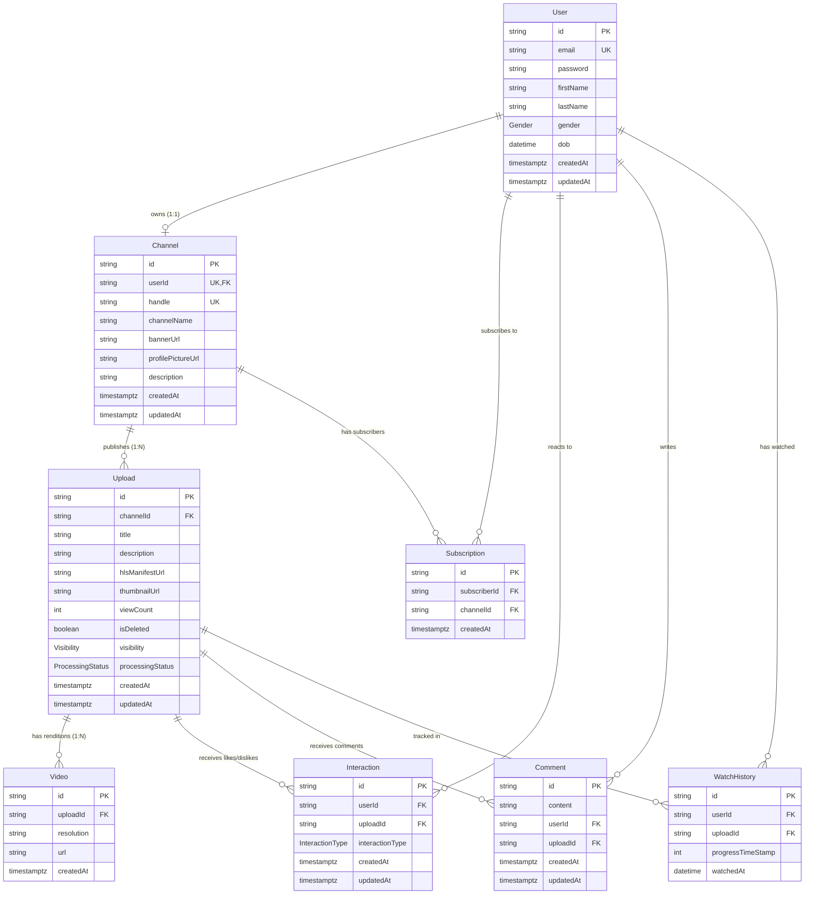

# Chapter 3: Database & Prisma ORM Architecture

This guide explains how Vion stores metadata, how relational entities connect, and how the backend communicates with **Neon PostgreSQL** using **Prisma ORM 8 RC** (`prisma-next`).

---

## 1. Relational Database vs Object Storage

A fundamental concept in modern video platforms is **separating metadata from media bytes**:

- **Neon PostgreSQL** stores **structured metadata**: who created an account, which channel owns which video, view counts, comment text, user likes, and the public URLs pointing to media files.
- **Supabase Storage** stores **binary media payloads**: multi-gigabyte MP4 files, HLS playlists (`.m3u8`), video segments (`.ts`), and thumbnail images (`.jpg`).

```
┌────────────────────────────────────────┐       ┌──────────────────────────────────────┐
│          PostgreSQL Database           │       │            Object Storage            │
├────────────────────────────────────────┤       ├──────────────────────────────────────┤
│ - User records (email, password hash)  │       │ - Raw uploaded video files (.mp4)    │
│ - Channel handles, titles, descriptions│       │ - Transcoded HLS playlists (.m3u8)   │
│ - Upload records & view counts         │       │ - Encrypted video chunks (.ts)       │
│ - Comments & Like reactions            │       │ - Poster & thumbnail images (.jpg)   │
│ - Storage URLs & processing statuses   │       │                                      │
└────────────────────────────────────────┘       └──────────────────────────────────────┘
```

> **Why not store video files in PostgreSQL?**
> Databases are optimized for transactional queries, indexing, and structured lookups. Storing large binary files (BLOBs) inside PostgreSQL bloats database backups, exhausts server memory, clogs database connection pools, and makes point-in-time recovery slow and expensive.

---

## 2. Complete Entity Relationship Diagram (ERD)

Here is the exact entity relationship model defined in [`backend/src/prisma/contract.prisma`](file:///f:/VS%20CODE/Codes/Projects/Vion%20youtube/backend/src/prisma/contract.prisma):



---

## 3. Critical Discovery: The `Upload` vs `Video` Reality

In early architectural plans (such as `vion_plan.md`), the documentation referred to separate concepts:
- "Upload session" (a temporary draft).
- "Published Video" (a completed public video entity).

### The Ground Truth in the Schema:
In the actual Prisma schema, **there is NO separate `PublishedVideo` table**. 

1. **`Upload` is the single canonical entity** for the entire lifecycle:
   - When created, it represents an ingest draft (`processingStatus: PENDING`, `visibility: PRIVATE`).
   - During transcoding, its state changes (`processingStatus: TRANSCODING`).
   - Once encoded, its manifest URL is set (`hlsManifestUrl: "https://..."`, `processingStatus: COMPLETED`).
   - When the creator publishes it, its visibility updates (`visibility: PUBLIC`).
   - Comments, likes, watch history, and views **all link directly to `Upload.id`**.
2. **`Video` represents individual transcoded renditions**:
   - The `Video` model does *not* represent the video project as a whole.
   - It represents a specific output quality (e.g. `resolution: "1080p"`, `resolution: "720p"`) with its individual playlist URL, linked back via `uploadId`.

```
                    ┌───────────────────────────────┐
                    │            Upload             │
                    │   (Canonical Video Record)    │
                    │   id: "upl_123"               │
                    │   title: "Tokyo Travel Vlog"  │
                    │   hlsManifestUrl: "master.m3u8│
                    └───────────────┬───────────────┘
                                    │
           ┌────────────────────────┼────────────────────────┐
           ▼                        ▼                        ▼
 ┌───────────────────┐    ┌───────────────────┐    ┌───────────────────┐
 │   Video (1080p)   │    │   Video (720p)    │    │   Video (480p)    │
 │ id: "vid_1"       │    │ id: "vid_2"       │    │ id: "vid_3"       │
 │ uploadId:upl_123  │    │ uploadId:upl_123  │    │ uploadId:upl_123  │
 │ resolution:1080p  │    │ resolution:720p   │    │ resolution:480p   │
 │ url: "1080p.m3u8" │    │ url: "720p.m3u8"  │    │ url: "480p.m3u8"  │
 └───────────────────┘    └───────────────────┘    └───────────────────┘
```

---

## 4. Model-by-Model Breakdown

### 4.1. `User`
Represents an authenticated human account on the platform.
- **`id`**: Primary key (UUID string).
- **`email`**: Unique user email address (`@unique`).
- **`password`**: Bcrypt hash string (never stored in plaintext).
- **`firstName`, `lastName`**: User's real name.
- **`gender`**: Enum (`MALE`, `FEMALE`, `OTHER`).
- **`dob`**: Date of birth (optional `DateTime`).
- **Relationships**:
  - `channel`: One-to-one relationship with `Channel` (`User.channel?`).
  - `interactions`: One-to-many list of likes/dislikes cast by this user.
  - `comments`: One-to-many list of comments posted by this user.
  - `watchHistory`: One-to-many list of videos watched by this user.
  - `subscriptions`: One-to-many list of channels this user is subscribed to.

### 4.2. `Channel`
Represents a content creator identity. In Vion, users do not post videos directly; their channel posts videos.
- **`id`**: Primary key (UUID).
- **`userId`**: Foreign key pointing to `User.id` (`@unique`). One user can have exactly one channel.
- **`handle`**: Unique creator identifier (e.g. `@techwithtim`, `@vion_official`).
- **`channelName`**: Display name of the channel.
- **`bannerUrl`, `profilePictureUrl`**: Storage URLs for branding images.
- **`description`**: Creator biography.
- **Relationships**:
  - `user`: Belongs to `User`.
  - `uploads`: One-to-many list of videos created by this channel.
  - `subscribers`: One-to-many list of subscriptions pointing to this channel.

### 4.3. `Subscription`
Tracks viewer-to-creator subscriptions.
- **`subscriberId`**: The `User.id` who clicked "Subscribe".
- **`channelId`**: The `Channel.id` receiving the subscription.
- **Unique Constraint (`@@unique([channelId, subscriberId])`)**: Prevents duplicate subscriptions. A user cannot subscribe to the same channel twice.

### 4.4. `Upload` (The Core Media Entity)
The central model for all video-related operations in Vion.
- **`id`**: Unique UUID assigned at upload initiation.
- **`channelId`**: The owning channel.
- **`title`**: Video title (max 200 chars).
- **`description`**: Video description (markdown text).
- **`hlsManifestUrl`**: Public URL to `master.m3u8` in Supabase Storage. Set once transcoding completes.
- **`thumbnailUrl`**: Public URL to the video cover image (`.jpg`).
- **`viewCount`**: Integer counter incremented when watched.
- **`isDeleted`**: Boolean flag for **soft deletion**. Videos are never deleted from PostgreSQL immediately; setting `isDeleted = true` hides them from feeds while preserving referential integrity.
- **`visibility`**: Enum controlling access:
  - `PUBLIC`: Appears in search results, home feed, channel pages.
  - `UNLISTED`: Hidden from feeds/search; only accessible via direct link.
  - `PRIVATE`: Only accessible by the channel owner.
- **`processingStatus`**: Enum tracking the transcoding lifecycle:
  - `PENDING`: Upload record created; client preparing to upload raw file.
  - `UPLOADING`: Client uploading bytes directly to Supabase Storage.
  - `TRANSCODING`: Raw file verified; FFmpeg worker is generating HLS renditions.
  - `COMPLETED`: Transcoding succeeded; ready for playback.
  - `FAILED`: Transcoding crashed or timed out.

### 4.5. `Video` (Rendition Records)
Stores individual quality renditions generated by FFmpeg.
- **`uploadId`**: Foreign key to `Upload.id`.
- **`resolution`**: Text label (e.g. `"1080p"`, `"720p"`, `"480p"`, `"360p"`).
- **`url`**: Direct storage URL to the variant playlist (e.g. `.../hls/1080p/1080p.m3u8`).

### 4.6. `Interaction` (Likes & Dislikes)
Tracks viewer reactions to videos.
- **`userId`**: Who reacted.
- **`uploadId`**: Video reacted to.
- **`interactionType`**: Enum (`LIKE` or `DISLIKE`).
- **Unique Constraint (`@@unique([userId, uploadId])`)**: A user can have at most one reaction record per video. Liking a video that was previously disliked updates the existing record from `DISLIKE` to `LIKE`.

### 4.7. `Comment`
Viewer discussion on videos.
- **`id`**: Unique comment UUID.
- **`content`**: Text of the comment.
- **`userId`**: Author of the comment.
- **`uploadId`**: Video being commented on.

### 4.8. `WatchHistory`
Tracks resume positions and view history.
- **`userId`**: Viewer ID.
- **`uploadId`**: Video ID.
- **`progressTimeStamp`**: Integer timestamp in seconds where the user stopped playback.
- **`watchedAt`**: Timestamp of the latest playback session.
- **Unique Constraint (`@@unique([userId, uploadId])`)**: Each user has a single progress row per video; watching again updates `progressTimeStamp` and `watchedAt`.

---

## 5. Prisma ORM 8 RC & `prisma-next`

Vion uses **Prisma ORM 8 RC** with the `@prisma/orm-postgres` engine (`prisma-next`).

### How It Differs from Prisma 5 / 6
In traditional Prisma, running `npx prisma generate` created a heavy node_modules bundle with platform-specific binary engines (`query-engine.node`).

In Prisma ORM 8 RC:
1. **Contract-Based Schema**: The schema file [`backend/src/prisma/contract.prisma`](file:///f:/VS%20CODE/Codes/Projects/Vion%20youtube/backend/src/prisma/contract.prisma) is compiled into a lightweight JSON AST contract:
   ```bash
   bun run contract:emit
   ```
   This generates `contract.json` and TypeScript declaration `contract.d.ts`.
2. **Pure TypeScript Driver**: The runtime client is initialized via `@prisma/orm-postgres/runtime` in [`backend/src/prisma/db.ts`](file:///f:/VS%20CODE/Codes/Projects/Vion%20youtube/backend/src/prisma/db.ts):
   ```typescript
   import postgres from "@prisma/orm-postgres/runtime";
   import type { Contract } from "./contract.d";
   import contractJson from "./contract.json" with { type: "json" };
   import { DB_URL } from "../config/config";

   export const db = postgres<Contract>({
     contractJson,
     url: DB_URL!,
   });
   ```

### How to Query Entities in Code
In Vion services, entities are accessed via `db.orm.public`:
```typescript
const { Upload, Channel, Video, User } = db.orm.public;

// Find first matching record
const upload = await Upload.where({ id: uploadId, isDeleted: false }).first();

// Create a record
const newUpload = await Upload.create({
  id: uploadId,
  channelId: channel.id,
  title: data.title,
  visibility: "PRIVATE",
  processingStatus: "PENDING",
});

// Update a record
await Upload.where({ id: uploadId }).update({
  processingStatus: "TRANSCODING",
});

// Relational inclusions (joins)
const videoWithChannel = await Upload.where({ id: uploadId })
  .include("channel", (c) => c.select("id", "channelName", "handle", "profilePictureUrl"))
  .first();
```

---

## 6. Neon Serverless PostgreSQL Configuration

Vion connects to **Neon PostgreSQL** over an SSL-encrypted connection.

### Connection Architecture
- **Serverless Autoscaling**: Neon separates compute from storage. When traffic spikes, compute instances scale dynamically.
- **Connection Pooling**: Neon provides built-in PgBouncer connection pooling. 
- **Configuration Path**: Set via `DATABASE_URL` in `backend/.env`.

> [!CAUTION]
> **Credential Safety Rule**: Never commit real database connection strings or passwords to Git. Always use placeholders like:
> `DATABASE_URL="postgresql://neondb_owner:<NEON_PASSWORD>@ep-sample.us-east-2.aws.neon.tech/neondb?sslmode=require"`

---

## 7. Safe Database Operations & Commands

When developing locally or deploying, use these verified scripts from `backend/package.json`:

```bash
# 1. Emit updated Prisma contract when contract.prisma changes
bun run contract:emit

# 2. Run schema verification script
bun run verify

# 3. Check TypeScript types across Prisma models
bun run typecheck
```

> [!WARNING]
> **Destructive Commands**: Never run `prisma migrate reset` or `db push --force-reset` on production or shared databases, as this will drop all existing user tables and wipe production metadata!

---

## 8. What to Remember

1. **PostgreSQL stores metadata; Supabase stores video bytes.** Never store raw media inside database rows.
2. **`Upload` is the canonical video entity.** There is no separate `PublishedVideo` table. `Video` stores multi-bitrate renditions (1080p, 720p, etc.).
3. **Soft Deletion**: Videos are marked `isDeleted: true` to preserve comment history and view metrics.
4. **Unique Constraints Prevent Race Conditions**: `@@unique([channelId, subscriberId])` and `@@unique([userId, uploadId])` ensure users cannot double-subscribe or double-like at the database level.
5. **Prisma ORM 8 RC uses `contract:emit`**: When modifying `contract.prisma`, run `bun run contract:emit` to update `contract.json`.
