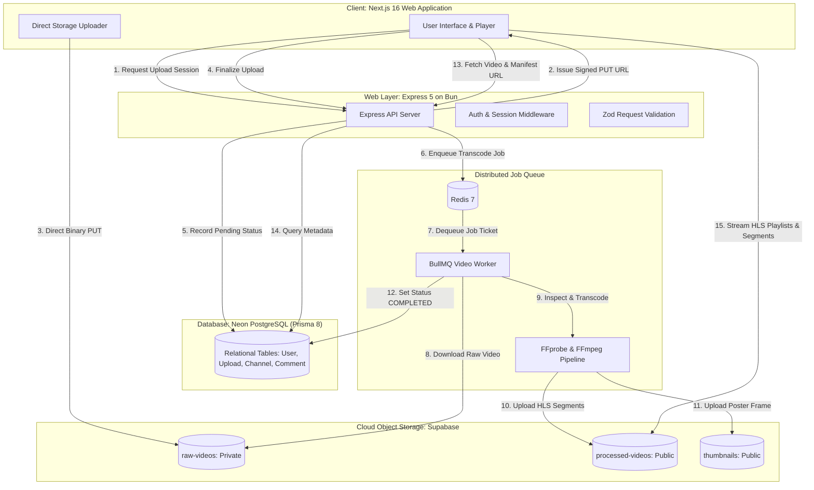

# Chapter 01 — Project Overview & Architecture

## 1. What is Vion?

**Vion** is an independent, high-performance video-sharing platform engineered to deliver adaptive bitrate streaming, social engagement, and creator tools.

Building a video platform is fundamentally different from building a standard CRUD application (like a blog or an e-commerce store). A single 1080p video file can easily be **500 Megabytes to 4 Gigabytes** in size. If an application attempts to receive, process, and stream video files through a traditional web server:
1. The server's RAM and CPU will quickly choke while transcoding video.
2. Web requests will time out.
3. Users with slower internet connections will experience constant buffering or failure to load.

Vion solves these challenges using **distributed media architecture**:
- **Direct-to-storage uploads** prevent gigabytes of raw video from overwhelming the application server.
- **Background queue workers** transcode videos asynchronously without slowing down API requests.
- **HTTP Live Streaming (HLS)** splits videos into multi-resolution segments (1080p, 720p, 480p, 360p) so players automatically adapt to any user's network speed.

---

## 2. Core Platform Capabilities

| Capability | Status | Description |
|---|---|---|
| **Direct Binary Video Upload** | `[IMPLEMENTED]` | Browser requests a pre-signed session, then streams raw video directly to Supabase Object Storage using an HTTP `PUT` request with progress tracking. |
| **Asynchronous Transcoding** | `[IMPLEMENTED]` | BullMQ queue and worker inspect raw uploads using FFprobe, generate multi-resolution HLS streams with FFmpeg, and upload playlists to cloud storage. |
| **Adaptive Bitrate Playback** | `[IMPLEMENTED]` | Custom web player built with `hls.js` dynamically switches between 1080p, 720p, 480p, and 360p based on viewer bandwidth. |
| **Social & Community Features** | `[IMPLEMENTED]` | Channel subscriptions, like/dislike counts, video comments (with author deletion), and view counters debounced by IP and user ID. |
| **Watch History & Progress** | `[IMPLEMENTED]` | Players periodically synchronize playback timestamps to `PUT /api/v1/history/:videoId/progress` so users can resume watching. |
| **Global Search & Discovery** | `[IMPLEMENTED]` | Real database-driven search matching video titles, descriptions, and channel handles with autocomplete suggestions. |
| **Notifications System** | `[PARTIALLY IMPLEMENTED]` | API endpoints return canonical empty envelopes (`items: []`). The underlying database schema does not yet include a `Notification` table. |
| **Admin Panel & Roles** | `[PLANNED]` | Endpoints are defined in `vion_plan.md`, but no administrative role exists on the database `User` model. |

---

## 3. Technology Stack & Why Each Piece Exists

Understanding software architecture means understanding **why** a tool is chosen, not just which tools are installed:

```
┌─────────────────────────────────────────────────────────────────────────────┐
│                             THE VION TECH STACK                             │
├───────────────────────┬─────────────────────────────┬───────────────────────┤
│ Layer                 │ Technology                  │ Engineering Purpose   │
├───────────────────────┼─────────────────────────────┼───────────────────────┤
│ Frontend Web App      │ Next.js 16 (App Router)     │ Server Components,    │
│                       │ React 19, TypeScript        │ fast routing, SEO.    │
├───────────────────────┼─────────────────────────────┼───────────────────────┤
│ Design & Motion       │ Tailwind CSS v4, shadcn/ui  │ Neutral theme system, │
│                       │ GSAP 3, Lenis Scroll        │ 60fps animations.     │
├───────────────────────┼─────────────────────────────┼───────────────────────┤
│ API Web Server        │ Express 5 on Bun Runtime    │ Fast JSON API,        │
│                       │ TypeScript, Zod, JWT        │ cookies, routing.     │
├───────────────────────┼─────────────────────────────┼───────────────────────┤
│ Relational Database   │ Neon PostgreSQL             │ Serverless metadata,  │
│                       │ Prisma ORM 8 RC             │ relations, indexes.   │
├───────────────────────┼─────────────────────────────┼───────────────────────┤
│ Object Storage        │ Supabase Storage (S3 API)   │ Stores large media:   │
│                       │ 3 isolated buckets          │ raw, HLS, thumbnails. │
├───────────────────────┼─────────────────────────────┼───────────────────────┤
│ Job Queue & Cache     │ Redis 7 (`redis:7-alpine`)  │ Job deduplication,    │
│                       │ BullMQ v6.3                 │ exponential backoff.  │
├───────────────────────┼─────────────────────────────┼───────────────────────┤
│ Media Pipeline        │ FFmpeg 8, FFprobe           │ Codec conversion,     │
│                       │ Child process spawn         │ HLS segmentation.     │
└───────────────────────┴─────────────────────────────┴───────────────────────┘
```

### Why Bun?
[Bun](https://bun.sh) is a modern JavaScript runtime and package manager with native TypeScript execution, built-in test runners, and instant startup times. In Vion, Bun runs both the Express API server and the background transcoding worker.

### Why Express?
Express provides predictable HTTP request/response lifecycles, battle-tested cookie parsing, and clean middleware separation. It handles client requests (authentication, search queries, channel metadata) and returns JSON in milliseconds.

### Why Neon PostgreSQL?
A relational database is designed for structured, queryable data:
- "Who uploaded this video?"
- "Did this user like this video?"
- "What comments belong to this video?"
Neon provides serverless PostgreSQL with connection pooling, zero-maintenance scaling, and strict relational integrity. **Neon stores metadata (titles, view counts, relations), NEVER raw video files.**

### Why Supabase Object Storage?
Relational databases are terrible at storing gigabytes of binary data. Object storage (S3-compatible) is designed specifically for unstructured binary assets:
- Videos are written once and read millions of times.
- Files are distributed directly to browsers via content delivery networks (CDNs).
- Storage buckets provide isolated permissions (`raw-videos` is private; `processed-videos` is public).

### Why Redis & BullMQ?
Transcoding a 5-minute video can take 30 to 90 seconds of continuous 100% CPU time. If Express tried to execute FFmpeg inside an HTTP request, the client's browser would time out after 30 seconds, and the server would freeze.
Redis and BullMQ solve this:
1. Express simply places a small "job ticket" (containing only the video ID) into Redis.
2. Express immediately responds to the client: `"Upload finalized; video is processing."`
3. A separate worker process picks up the job from Redis, runs FFmpeg, and notifies the database when finished.

---

## 4. High-Level Architecture Diagram



---

## 5. Repository Directory Layout

```
Vion youtube/
├── docs/                             # The Technical Handbook (You are here)
│   ├── README.md                     # Table of contents & navigation
│   ├── PROJECT_OVERVIEW.md           # Chapter 01: Overall architecture
│   ├── BACKEND_ARCHITECTURE.md       # Chapter 02: Express, middleware, routing
│   ├── DATABASE_AND_PRISMA.md        # Chapter 03: Neon schema & models
│   ├── VIDEO_UPLOAD_AND_PROCESSING.md# Chapter 04: Upload lifecycle
│   ├── VIDEO_FORMATS_...PLAYBACK.md  # Chapter 05: FFmpeg, HLS, streaming
│   ├── STORAGE_QUEUE_AND_WORKERS.md  # Chapter 06: Supabase, Redis, BullMQ
│   ├── API_REFERENCE.md              # Chapter 07: Canonical endpoint contracts
│   ├── SECURITY_FAILURES_...md       # Chapter 08: Security & troubleshooting
│   ├── LOCAL_DEVELOPMENT.md          # Chapter 09: Setup guide
│   └── FRONTEND_OVERVIEW.md          # Chapter 10: Next.js frontend
├── backend/                          # Express 5 API & Transcoding Worker
│   ├── src/
│   │   ├── config/                   # Environment schemas & transcoding profiles
│   │   ├── middlewares/              # Auth, error handling, rate limiting
│   │   ├── modules/                  # Feature domain controllers & routes
│   │   │   ├── auth/                 # Signin, signup, Google auth, tokens
│   │   │   ├── user/                 # User profiles, passwords, subscriptions
│   │   │   ├── channel/              # Creator channels, handles, bios
│   │   │   ├── upload/               # Upload sessions, signed URLs, status
│   │   │   ├── video/                # Playback, publication, reactions
│   │   │   ├── comment/              # Video comments & deletion
│   │   │   ├── watchHistory/         # Progress synchronization & history
│   │   │   ├── feed/                 # Public video discovery feed
│   │   │   ├── search/               # Full-text content search & suggestions
│   │   │   ├── categories/           # Content category tags
│   │   │   ├── notifications/        # Notification stubs
│   │   │   ├── admin/                # Administrative routes
│   │   │   └── health/               # Liveness & readiness probes
│   │   ├── prisma/                   # contract.prisma, DB connection
│   │   ├── queue/                    # Redis client & BullMQ queue definition
│   │   ├── services/                 # Media inspection, storage, transcoding
│   │   ├── utils/                    # AppError, asyncHandler, process spawner
│   │   ├── worker/                   # Worker process entry point & pipeline
│   │   └── index.ts                  # Main Express application entry point
│   ├── docker-compose.yml            # Local Redis & PostgreSQL services
│   ├── package.json                  # Backend dependencies & scripts
│   └── tsconfig.json                 # TypeScript compiler configuration
├── frontend/                         # Next.js 16 App Router Client
│   ├── src/
│   │   ├── app/                      # Routes: /, watch, channel, history, etc.
│   │   ├── components/               # UI components, HLS player, navigation
│   │   │   ├── navigation/           # Header, Sidebar (GSAP indicator), Palette
│   │   │   ├── studio/               # UploadDialog (drag-and-drop studio)
│   │   │   ├── video/                # HlsVideoPlayer, VideoFeed, VideoCard
│   │   │   └── ui/                   # Radix UI / shadcn primitives
│   │   ├── context/                  # AuthContext (sessions, current user)
│   │   ├── lib/                      # Axios client, GSAP animation tokens
│   │   ├── providers/                # Lenis smooth scroll, ThemeProvider
│   │   ├── services/                 # Typed frontend API services
│   │   └── types/                    # TypeScript data contracts & envelopes
│   └── package.json                  # Frontend dependencies
├── vion_plan.md                      # Canonical API contract specification
└── VION_CONTEXT_MASTER.md            # Living engineering implementation record
```

---

## 6. What to Remember

1. **Vion separates compute from storage**: Web servers respond to HTTP requests; object storage holds video bytes; workers execute transcoding; PostgreSQL stores relational metadata.
2. **Never stream gigabytes of raw video through Express**: Uploads travel directly from browser to storage using signed URLs; downloads travel directly from storage to the video player.
3. **Never execute video processing inside an HTTP handler**: Heavy work must be placed on a background queue (BullMQ/Redis) so API response times remain under 50 milliseconds.
