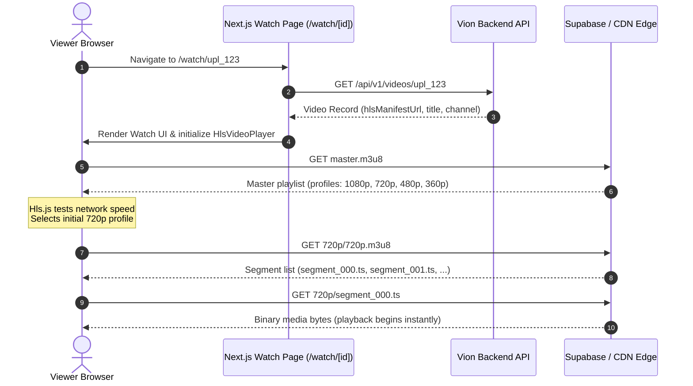

# Chapter 5: Video Formats, FFmpeg Transcoding, Thumbnails & HLS Playback

This handbook teaches the core principles of digital video engineering from the ground up, explaining how Vion uses **FFprobe**, **FFmpeg**, and **HTTP Live Streaming (HLS)** to deliver smooth, adaptive video playback.

---

## Part A: Video Fundamentals

If you are coming from standard web development (where images are just JPEGs and text is JSON), video engineering can seem overwhelming. Let's start with foundational concepts.

### 1. Containers vs Codecs
People often say *"I uploaded an MP4 video."* But an MP4 is **not** a video encoding; it is a **container**.

```
┌────────────────────────────────────────────────────────┐
│                   MP4 Container (.mp4)                 │
│                                                        │
│   ┌───────────────────────────┐  ┌───────────────────┐ │
│   │       Video Track         │  │    Audio Track    │ │
│   │    Codec: H.264 (AVC)     │  │    Codec: AAC     │ │
│   │    (Compressed frames)    │  │    (Audio wave)   │ │
│   └───────────────────────────┘  └───────────────────┘ │
│                                                        │
│   ┌───────────────────────────┐  ┌───────────────────┐ │
│   │     Subtitles / Text      │  │     Metadata      │ │
│   │       (Timed text)        │  │ (Duration, moov)  │ │
│   └───────────────────────────┘  └───────────────────┘ │
└────────────────────────────────────────────────────────┘
```

- **The Container (`.mp4`, `.mov`, `.mkv`, `.webm`)**: A file format wrapper that packages compressed video tracks, audio tracks, subtitles, and metadata indexes together into a single file.
- **The Codec (Coder-Decoder, e.g. H.264, HEVC, VP9, AV1)**: The mathematical compression algorithm used to compress raw image frames into small byte representations and decode them during playback.

> **Why Vion targets H.264 (AVC) and AAC:**
> While newer codecs like AV1 and VP9 offer higher compression efficiency, **H.264 video with AAC audio boasts virtually 100% hardware decoder support** across every iPhone, Android device, smart TV, and desktop browser manufactured in the last 15 years.

---

### 2. Resolution vs Bitrate: Why Resolution is Not Quality

- **Resolution**: The spatial dimensions of each video frame in pixels ($Width \times Height$).
  - 1080p: $1920 \times 1080$ pixels ($\approx 2.07\text{ million pixels per frame}$)
  - 720p: $1280 \times 720$ pixels ($\approx 0.92\text{ million pixels per frame}$)
  - 480p: $854 \times 480$ pixels ($\approx 0.41\text{ million pixels per frame}$)
  - 360p: $640 \times 360$ pixels ($\approx 0.23\text{ million pixels per frame}$)
- **Bitrate**: The quantity of media data transmitted per second (e.g. $4{,}500\text{ kbps} = 4.5\text{ megabits per second}$).
- **The Core Law of Video Size**:
  $$\text{File Size} \approx \text{Total Bitrate} \times \text{Duration}$$

> [!IMPORTANT]
> **Resolution is a canvas; bitrate is the paint.**
> A 1080p video encoded at a starved bitrate of $500\text{ kbps}$ will look blurry, pixelated, and blocky (macroblocking artifacts). A 720p video encoded at $3{,}000\text{ kbps}$ will look crystal clear. Higher resolution requires proportional bitrate to maintain fidelity.

---

### 3. Temporal Compression: I-Frames, P-Frames, and B-Frames

Uncompressed 1080p video at 30 FPS would consume over **$1.4\text{ gigabits per second}$** ($1920 \times 1080 \times 24\text{ bits} \times 30\text{ fps}$).
Codecs achieve 99% compression by exploiting two types of redundancy:
1. **Spatial Redundancy**: Areas of a single frame that are identical (e.g. blue sky).
2. **Temporal Redundancy**: Portions of a frame that do not change from one second to the next (e.g. a talking head where only the mouth moves while the background remains stationary).

```
   [ I-Frame ] ───────► [ P-Frame ] ───────► [ B-Frame ] ───────► [ I-Frame ]
(Keyframe: Full image)  (Predicts from past) (Predicts past/future)(New Keyframe)
```

- **I-Frame (Intra-frame / Keyframe)**: A complete, standalone image (like a JPEG). Does not require any other frame to be decoded.
- **P-Frame (Predicted frame)**: Stores only the differences/movement compared to the previous frame.
- **B-Frame (Bi-directional frame)**: Stores differences calculated from both preceding and future frames for maximum compression.

---

### 4. The Anti-Upscaling Principle

In Vion, if a user uploads a video recorded in 720p, **the system strictly refuses to generate a 1080p rendition**.

```
Source: 720p ──┬──► Generate 720p rendition (2,500 kbps)
               ├──► Generate 480p rendition (1,200 kbps)
               └──► Generate 360p rendition (700 kbps)
               ❌ NEVER upscale to 1080p!
```

> **Why never upscale?**
> Upscaling does not add missing details; it creates blurred, interpolated pixels while tripling file size, wasting worker CPU encoding time, wasting Supabase storage, and consuming viewer cellular data for zero visual benefit.

---

## Part B: FFprobe Media Inspection

FFprobe is a multimedia stream analyzer bundled with FFmpeg. It reads file headers and stream indexes **without decoding the entire video**, completing in under 50 milliseconds.

### The Actual FFprobe Command Used by Vion
Implemented in [`backend/src/services/mediaService.ts#L111-L116`](file:///f:/VS%20CODE/Codes/Projects/Vion%20youtube/backend/src/services/mediaService.ts#L111-L116):

```bash
ffprobe -v error -print_format json -show_format -show_streams /tmp/media/upl_123/source_input.mp4
```

| Flag | Purpose | Why Vion Uses It |
| :--- | :--- | :--- |
| `-v error` | Log verbosity | Suppresses harmless banners and warnings; only outputs critical errors. |
| `-print_format json` | Output format | Returns structured JSON directly parseable by TypeScript via `JSON.parse()`. |
| `-show_format` | Container metadata | Extracts overall container duration, total bitrate, container tags. |
| `-show_streams` | Track details | Inspects individual video and audio streams (codec, dimensions, FPS, channels). |

### What Vion Validates with FFprobe:
1. **Valid Video Stream**: Rejects files that have `.mp4` extensions but only contain audio or corrupted data.
2. **Supported Codecs**: Verifies video codec is in `SUPPORTED_VIDEO_CODECS` (`h264`, `hevc`, `vp8`, `vp9`, `av1`, `mpeg4`).
3. **Dimensions & Duration**: Checks that `width > 0`, `height > 0`, and `duration > 0`.
4. **Frame Rate Calculation**: Extracts and evaluates `r_frame_rate` (e.g. `"30000/1001"` parsed to `29.97`).
5. **Audio Stream Detection**: Determines if audio is present. If missing, FFmpeg injects a silent audio track during transcoding so mobile browsers do not stall.

---

## Part C: FFmpeg & Adaptive Bitrate Transcoding

### Vion's Standard Quality Ladder
Defined in [`backend/src/config/transcodingProfiles.ts`](file:///f:/VS%20CODE/Codes/Projects/Vion%20youtube/backend/src/config/transcodingProfiles.ts):

| Profile | Dimensions | Video Bitrate | Peak Rate (`maxrate`) | Buffer (`bufsize`) | Audio Bitrate | Target Bandwidth |
| :---: | :---: | :---: | :---: | :---: | :---: | :---: |
| **1080p** | $1920 \times 1080$ | 4,500 kbps | 5,000 kbps | 9,000 kbps | 128 kbps | 5.2 Mbps |
| **720p** | $1280 \times 720$ | 2,500 kbps | 2,800 kbps | 5,000 kbps | 128 kbps | 2.95 Mbps |
| **480p** | $854 \times 480$ | 1,200 kbps | 1,400 kbps | 2,400 kbps | 96 kbps | 1.45 Mbps |
| **360p** | $640 \times 360$ | 700 kbps | 800 kbps | 1,400 kbps | 96 kbps | 890 kbps |

---

### The Real FFmpeg Command Executed by Vion
Implemented in [`backend/src/services/transcodingService.ts#L225-L270`](file:///f:/VS%20CODE/Codes/Projects/Vion%20youtube/backend/src/services/transcodingService.ts#L225-L270):

```bash
ffmpeg -y \
  -i /tmp/media/upl_123/source_input.mp4 \
  -c:v libx264 \
  -profile:v main \
  -preset veryfast \
  -b:v 2500k \
  -maxrate 2800k \
  -bufsize 5000k \
  -vf "scale=-2:720" \
  -r 30 \
  -g 180 \
  -keyint_min 180 \
  -sc_threshold 0 \
  -c:a aac \
  -b:a 128k \
  -ar 48000 \
  -f hls \
  -hls_time 6 \
  -hls_playlist_type vod \
  -hls_flags independent_segments \
  -hls_segment_filename "/tmp/media/upl_123/hls/720p/segment_%03d.ts" \
  "/tmp/media/upl_123/hls/720p/720p.m3u8"
```

### Line-by-Line Parameter Explanation:

1. **`-y`**: Overwrite output files without asking for confirmation.
2. **`-i source_input.mp4`**: Path to the raw downloaded video file.
3. **`-c:v libx264`**: Use the industry-standard H.264 video encoder (`x264`).
4. **`-profile:v main`**: H.264 Main Profile guarantees compatibility across legacy mobile chipsets.
5. **`-preset veryfast`**: Balances CPU compression speed versus file size. Enables workers to transcode files quickly without overloading server CPUs.
6. **`-b:v 2500k -maxrate 2800k -bufsize 5000k`**: Constrained Baseline (VBV Rate Control). Limits peak bitrate spikes so mobile data users do not experience sudden buffering.
7. **`-vf "scale=-2:720"`**: Scales the height to 720 pixels while automatically calculating width to maintain original aspect ratio. The `-2` forces width to be an **even number** (divisible by 2), which is strictly required by the YUV 4:2:0 chroma subsampling format.
8. **`-r 30`**: Normalizes frame rate to 30 frames per second.
9. **`-g 180 -keyint_min 180`**: **GOP (Group of Pictures) Keyframe Interval**.
   - With $30\text{ fps}$ and 6-second segments, $30 \times 6 = 180\text{ frames}$.
   - This forces a keyframe (I-frame) to occur **at exactly every 6 seconds**.
10. **`-sc_threshold 0`**: Disables dynamic scene-cut keyframe insertion. This ensures keyframes across all renditions (1080p, 720p, 480p) align at the exact same millisecond timestamps!
11. **`-c:a aac -b:a 128k -ar 48000`**: Encodes high-fidelity stereo audio using AAC at 128 kbps and 48 kHz sample rate.
12. **`-f hls`**: Output format is HTTP Live Streaming.
13. **`-hls_time 6`**: Target duration of each `.ts` video chunk is 6 seconds.
14. **`-hls_playlist_type vod`**: Marks the stream as Video-on-Demand (meaning the playlist is complete and will not have new segments appended live).
15. **`-hls_flags independent_segments`**: Adds `#EXT-X-INDEPENDENT-SEGMENTS` to the playlist header, certifying that every segment starts with an IDR keyframe and can be decoded independently.
16. **`-hls_segment_filename ".../segment_%03d.ts"`**: Filename template for segment chunks (`segment_000.ts`, `segment_001.ts`, etc.).

---

## Part D: HLS & Adaptive Bitrate Streaming

### What is HLS?
Developed by Apple (RFC 8216), **HTTP Live Streaming** breaks a continuous video into a master playlist, several variant playlists, and small 6-second video chunks (`.ts` files) served over plain HTTP.

```
                              Master Playlist (master.m3u8)
                       ┌────────────────────────────────────────┐
                       │ Describes all available quality levels │
                       └───────────────────┬────────────────────┘
                                           │
         ┌─────────────────────────────────┼─────────────────────────────────┐
         ▼                                 ▼                                 ▼
   1080p Playlist                    720p Playlist                     480p Playlist
    (1080p.m3u8)                      (720p.m3u8)                       (480p.m3u8)
  ┌───────────────┐                 ┌───────────────┐                 ┌───────────────┐
  │ segment_0.ts  │                 │ segment_0.ts  │                 │ segment_0.ts  │
  │ segment_1.ts  │                 │ segment_1.ts  │                 │ segment_1.ts  │
  │ segment_2.ts  │                 │ segment_2.ts  │                 │ segment_2.ts  │
  └───────────────┘                 └───────────────┘                 └───────────────┘
```

### The Master Playlist Anatomy (`master.m3u8`)
Generated in [`backend/src/services/transcodingService.ts#L330-L375`](file:///f:/VS%20CODE/Codes/Projects/Vion%20youtube/backend/src/services/transcodingService.ts#L330-L375):

```m3u8
#EXTM3U
#EXT-X-VERSION:3
#EXT-X-INDEPENDENT-SEGMENTS

#EXT-X-STREAM-INF:BANDWIDTH=5200000,AVERAGE-BANDWIDTH=4800000,RESOLUTION=1920x1080,CODECS="avc1.4d4028,mp4a.40.2",FRAME-RATE=30.000
1080p/1080p.m3u8

#EXT-X-STREAM-INF:BANDWIDTH=2950000,AVERAGE-BANDWIDTH=2650000,RESOLUTION=1280x720,CODECS="avc1.4d401f,mp4a.40.2",FRAME-RATE=30.000
720p/720p.m3u8

#EXT-X-STREAM-INF:BANDWIDTH=1450000,AVERAGE-BANDWIDTH=1320000,RESOLUTION=854x480,CODECS="avc1.4d401e,mp4a.40.2",FRAME-RATE=30.000
480p/480p.m3u8

#EXT-X-STREAM-INF:BANDWIDTH=890000,AVERAGE-BANDWIDTH=800000,RESOLUTION=640x360,CODECS="avc1.4d401e,mp4a.40.2",FRAME-RATE=30.000
360p/360p.m3u8
```

### How the Player Adapts Bitrate:
1. When playback begins, the player (e.g. `Hls.js`) fetches `master.m3u8`.
2. It measures the download speed of the first segment.
3. If bandwidth is high ($> 10\text{ Mbps}$ on Wi-Fi), it requests `1080p/segment_001.ts`.
4. If the viewer enters a tunnel or cell signal drops to $1.5\text{ Mbps}$, the player detects buffer depletion and seamlessly requests `480p/segment_002.ts`.
5. Because Vion strictly synchronized keyframe boundaries at 6-second intervals across all renditions, **the transition is instant with zero stutter, audio drop, or buffering pause!**

---

## Part E: Thumbnail Generation & Selection

### Frame Extraction Command
Implemented in [`backend/src/services/mediaService.ts#L306-L325`](file:///f:/VS%20CODE/Codes/Projects/Vion%20youtube/backend/src/services/mediaService.ts#L306-L325):

```bash
ffmpeg -ss 14.5 \
  -i /tmp/media/upl_123/source_input.mp4 \
  -frames:v 1 \
  -update 1 \
  -vf "scale=1280:720:force_original_aspect_ratio=decrease,pad=1280:720:(ow-iw)/2:(oh-ih)/2:black" \
  -q:v 2 \
  /tmp/media/upl_123/candidate_1.jpg
```

| Argument | Explanation |
| :--- | :--- |
| `-ss 14.5` (before `-i`) | **Fast input seeking**: Jumps directly to keyframe index near second 14.5 without decoding earlier seconds. |
| `-frames:v 1` | Instructs FFmpeg to stop immediately after extracting 1 video frame. |
| `-vf "scale=...pad=..."` | Fits non-standard aspect ratios into a pristine 16:9 canvas with cinematic black bars. |
| `-q:v 2` | JPEG quality level (2 represents near-lossless clarity). |

### Candidate Selection Algorithm
- If video duration $\le 1.0\text{ sec}$: Seeks near start ($0.1\text{ sec}$).
- If video duration $\le 5.0\text{ sec}$: Extracts at 25%, 50%, and 75%.
- Normal videos: Extracts 3 candidate frames at **15% (opening)**, **50% (middle)**, and **85% (climax)**.
- Default thumbnail is uploaded to `thumbnails` bucket and stored in `Upload.thumbnailUrl`.

---

## Part F: Delivery & Playback Sequence



---

## Part G: What to Remember

1. **Containers wrap; Codecs compress**: MP4 is the container; H.264 is the video codec; AAC is the audio codec.
2. **Never upscale**: Upscaling increases file size and encoding time without improving quality.
3. **Synchronized Keyframes (GOP Alignment) Enable ABR**: HLS requires `-g <fps*6>` and `-sc_threshold 0` so segment boundaries align perfectly across all renditions.
4. **Fast Seeking**: Placing `-ss` *before* `-i` tells FFmpeg to seek using stream indexes, extracting frames in milliseconds instead of reading every preceding byte.
5. **Direct Edge Delivery**: Media segments and manifests are fetched directly from CDN/Storage, never routed through the Express API server.
