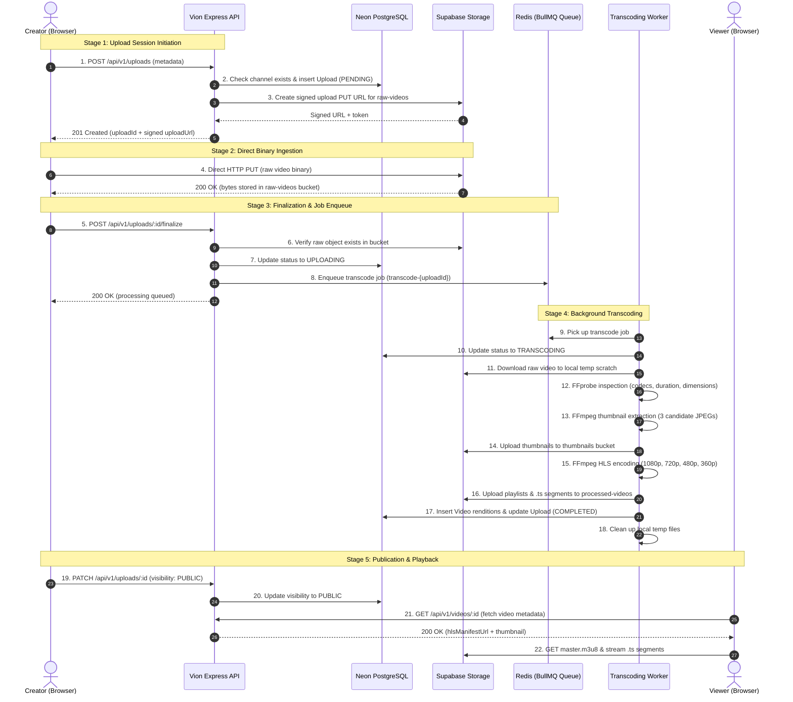

# Chapter 4: Video Upload & Processing Pipeline

This is one of the most critical documents in Vion. It walks through the complete lifecycle of a video from the moment a user clicks **"Select Video File"** in their browser to the moment that video is ready for adaptive bitrate playback worldwide.

---

## 1. Core Architectural Concepts Defined

Before walking through the code, let's clarify five terms that beginners often confuse:

| Concept | What It Actually Is | Where It Lives |
| :--- | :--- | :--- |
| **Upload Record** | The database row in PostgreSQL (`Upload`) tracking ownership, title, metadata, processing status, and final URLs. | Neon PostgreSQL |
| **Media Asset** | The physical binary files stored in object storage: the raw input MP4, the output `.m3u8` manifests, the `.ts` video chunks, and `.jpg` posters. | Supabase Storage |
| **Processing Job** | A background task queued in Redis (`video-transcoding`) that instructs a worker to run FFmpeg and FFprobe asynchronously without blocking HTTP requests. | Redis / BullMQ |
| **Published Video** | An upload whose `processingStatus` is `COMPLETED` and whose `visibility` is toggled from `PRIVATE` to `PUBLIC` by the creator. | Application State |
| **Playback Session** | A client-side video player instance (e.g. `HlsVideoPlayer`) requesting the master manifest, measuring network throughput, and downloading segments. | Browser Memory |

---

## 2. Complete Video Lifecycle Flowchart



---

## 3. Detailed Step-by-Step Breakdown

### Step 1: User Chooses a Video File
- **Component**: Frontend Browser UI ([`frontend/src/components/upload/UploadDialog.tsx`](file:///f:/VS%20CODE/Codes/Projects/Vion%20youtube/frontend/src/components/upload/UploadDialog.tsx)).
- **What Happens**: The user selects a video file (`.mp4`, `.mov`, `.webm`) using the file picker. The frontend reads file metadata locally: filename, byte size, and MIME type.
- **Status**: `[IMPLEMENTED]`

### Step 2: Frontend Sends Metadata to Backend
- **Endpoint**: `POST /api/v1/uploads`
- **Request Body**:
  ```json
  {
    "title": "Tokyo City Walk in 4K",
    "description": "Walking through Shibuya crossing at night.",
    "fileName": "tokyo_shibuya.mp4",
    "fileSize": 154829300,
    "contentType": "video/mp4"
  }
  ```
- **Implementation**: Handled by [`upload.controller.ts:createUpload`](file:///f:/VS%20CODE/Codes/Projects/Vion%20youtube/backend/src/modules/upload/upload.controller.ts#L6-L17).
- **Status**: `[IMPLEMENTED]`

### Step 3: Backend Validates & Creates Upload Record
- **Implementation**: [`upload.service.ts:createUpload`](file:///f:/VS%20CODE/Codes/Projects/Vion%20youtube/backend/src/modules/upload/upload.service.ts#L35-L65).
- **Validation**: `createUploadSchema.parse(input)` checks:
  - `title` is 1 to 200 characters.
  - `fileSize` is $\le 500\text{ MB}$ (`MAX_UPLOAD_SIZE_BYTES`).
  - `contentType` begins with `video/`.
- **Database Action**:
  - Queries `Channel.where({ userId }).first()`. If missing, aborts with `NO_CHANNEL`.
  - Inserts new row in `Upload` table:
    ```sql
    INSERT INTO "Upload" (id, "channelId", title, visibility, "processingStatus", "isDeleted")
    VALUES ('upl_123', 'chn_456', 'Tokyo City Walk in 4K', 'PRIVATE', 'PENDING', false);
    ```
- **Status**: `[IMPLEMENTED]`

### Step 4: Backend Creates Temporary Signed Storage URL
- **Implementation**: [`services/storageService.ts:createSignedUploadUrl`](file:///f:/VS%20CODE/Codes/Projects/Vion%20youtube/backend/src/services/storageService.ts#L99-L125).
- **Storage Action**:
  - Generates a server-controlled path in the private `raw-videos` bucket:
    `raw/<channelId>/<uploadId>/<uuid>_tokyo_shibuya.mp4`
  - Asks Supabase Storage for a **Signed PUT URL** valid for 1 hour.
- **Data Out**:
  ```json
  {
    "success": true,
    "data": {
      "id": "upl_123",
      "uploadUrl": "https://<supabase-project>.supabase.co/storage/v1/object/upload/sign/raw-videos/raw/chn_456/upl_123/...",
      "storageKey": "raw/chn_456/upl_123/source.mp4"
    }
  }
  ```
- **Status**: `[IMPLEMENTED]`

### Step 5: Browser Uploads Video Directly to Storage
- **Protocol**: Direct HTTP `PUT` from client browser to Supabase Storage signed URL.
- **Why this is critical**: The Express API server **never touches the 500 MB video payload**. The client streams bytes directly to Supabase object storage, keeping Express free to handle lightweight JSON requests.
- **Status**: `[IMPLEMENTED]`

### Step 6: Browser Finalizes the Upload
- **Endpoint**: `POST /api/v1/uploads/:uploadId/finalize`
- **Request Body**:
  ```json
  {
    "storageKey": "raw/chn_456/upl_123/source.mp4"
  }
  ```
- **Implementation**: [`upload.controller.ts:finalizeUpload`](file:///f:/VS%20CODE/Codes/Projects/Vion%20youtube/backend/src/modules/upload/upload.controller.ts#L95-L109).
- **Status**: `[IMPLEMENTED]`

### Step 7: Backend Verifies Raw Object in Storage
- **Implementation**: [`upload.service.ts:finalizeUpload`](file:///f:/VS%20CODE/Codes/Projects/Vion%20youtube/backend/src/modules/upload/upload.service.ts#L250-L330).
- **Integrity Check**: The backend queries `storageService.listFiles("raw-videos", "raw/chn_456/upl_123")`. If the file was not uploaded or is 0 bytes, the request is rejected with `RAW_MEDIA_NOT_FOUND`.
- **Database Action**: Updates `processingStatus` to `UPLOADING`.
- **Status**: `[IMPLEMENTED]`

### Step 8: Processing Job is Enqueued in BullMQ
- **Implementation**: [`queue/videoQueue.ts:enqueueTranscodeJob`](file:///f:/VS%20CODE/Codes/Projects/Vion%20youtube/backend/src/queue/videoQueue.ts#L45-L75).
- **Job Details**:
  - Queue Name: `video-transcoding`
  - Job ID: `transcode-upl_123` (Deterministic ID guarantees **idempotency**; duplicate finalization calls will not create duplicate queue jobs).
  - Job Payload: `{ uploadId: "upl_123", channelId: "chn_456", rawVideoKey: "...", title: "..." }`
- **Status**: `[IMPLEMENTED]`

### Step 9: Worker Picks Up Job & Probes Media with FFprobe
- **Implementation**: [`worker/transcodingWorker.ts`](file:///f:/VS%20CODE/Codes/Projects/Vion%20youtube/backend/src/worker/transcodingWorker.ts) and [`services/mediaService.ts:readVideoInfo`](file:///f:/VS%20CODE/Codes/Projects/Vion%20youtube/backend/src/services/mediaService.ts#L91-L185).
- **Actions**:
  - Updates DB state to `TRANSCODING`.
  - Downloads raw video to local temp scratch directory (`tmp/media/upl_123/source_input.mp4`).
  - Runs FFprobe:
    `ffprobe -v error -print_format json -show_format -show_streams source_input.mp4`
  - Validates container: confirms video stream exists, codec is supported (`h264`, `hevc`, `vp9`, `av1`), duration $> 0$, dimensions $> 0$.
- **Status**: `[IMPLEMENTED]`

### Step 10: Thumbnail Generation & Selection
- **Implementation**: [`services/mediaService.ts:makeThumbnails`](file:///f:/VS%20CODE/Codes/Projects/Vion%20youtube/backend/src/services/mediaService.ts#L210-L360).
- **Actions**:
  - Extracts 3 candidate frames at 15%, 50%, and 85% of duration.
  - Resizes to standard 1280x720 with black letterbox padding.
  - Uploads candidate JPEGs to `thumbnails` bucket.
  - Sets default `Upload.thumbnailUrl` in database.
- **Status**: `[IMPLEMENTED]`

### Step 11: Multi-Rendition HLS Encoding
- **Implementation**: [`services/transcodingService.ts:processVideoHlsPipeline`](file:///f:/VS%20CODE/Codes/Projects/Vion%20youtube/backend/src/services/transcodingService.ts#L430-L580).
- **Quality Ladder Selection**: Anti-upscaling logic ensures a 1080p source produces `1080p`, `720p`, `480p`, and `360p`, while a 720p source only produces `720p`, `480p`, and `360p`.
- **FFmpeg Execution**: Runs independent rendition passes generating 6-second `.ts` segments and variant `.m3u8` playlists with synchronized GOP keyframes.
- **Status**: `[IMPLEMENTED]`

### Step 12: Master Playlist Generation & Upload
- **Implementation**: [`services/transcodingService.ts:generateMasterPlaylist`](file:///f:/VS%20CODE/Codes/Projects/Vion%20youtube/backend/src/services/transcodingService.ts#L320-L380).
- **Actions**:
  - Creates `master.m3u8` combining `#EXT-X-STREAM-INF` profiles for each encoded rendition.
  - Uploads all `.m3u8` playlists and `.ts` segments to `processed-videos` bucket under `processed/<channelId>/<uploadId>/hls/`.
- **Status**: `[IMPLEMENTED]`

### Step 13: Database Updated to COMPLETED
- **Implementation**: [`services/transcodingService.ts:recordSuccessfulTranscode`](file:///f:/VS%20CODE/Codes/Projects/Vion%20youtube/backend/src/services/transcodingService.ts#L600-L650).
- **Database Action**:
  - Inserts rendition records into `Video` table (`resolution: "1080p"`, `url: "..."`, etc.).
  - Updates `Upload` record:
    ```sql
    UPDATE "Upload"
    SET "processingStatus" = 'COMPLETED',
        "hlsManifestUrl" = 'https://<supabase>/storage/v1/object/public/processed-videos/processed/chn_456/upl_123/hls/master.m3u8',
        "updatedAt" = NOW()
    WHERE id = 'upl_123';
    ```
- **Cleanup**: Deletes local temporary files in `tmp/media/upl_123`.
- **Status**: `[IMPLEMENTED]`

### Step 14: Creator Publishes Video
- **Endpoint**: `PATCH /api/v1/uploads/:uploadId` or `POST /api/v1/videos/:id/publish`
- **Request Body**:
  ```json
  {
    "visibility": "PUBLIC"
  }
  ```
- **Result**: The video becomes visible in home feeds, search results, and creator channel pages.
- **Status**: `[IMPLEMENTED]`

---

## 4. Failure Handling & Retry Logic

Video encoding involves large files, heavy CPU utilization, and external network storage. Here is how Vion handles failures:

```
┌──────────────────────────────────────┬─────────────────────────────────────────────────────────────┐
│ Failure Point                        │ Behavior & Recovery Strategy                                │
├──────────────────────────────────────┼─────────────────────────────────────────────────────────────┤
│ Client network disconnects on upload │ Signed URL expires in 1 hour; no orphaned DB change occurs. │
│ Client calls finalize on empty file  │ Backend checks file size; rejects with RAW_MEDIA_NOT_FOUND. │
│ Corrupted video container            │ FFprobe fails during stage 9; job marked FAILED, no transcode.│
│ Worker CPU crashes during encode     │ BullMQ catches uncaught error; retries up to 3 times.       │
│ 3 consecutive encoding failures      │ DB status set to FAILED; error logged; temp files purged.   │
└──────────────────────────────────────┴─────────────────────────────────────────────────────────────┘
```

---

## 5. What to Remember

1. **Direct-to-Storage Architecture**: The browser uploads directly to Supabase via presigned URLs; Express never handles raw video data streams.
2. **Deterministic BullMQ Job IDs**: `transcode-${uploadId}` ensures that accidental double-clicks or repeated finalize requests will not spawn competing worker tasks.
3. **Strict Validation Before Transcoding**: FFprobe checks codecs, duration, and dimensions before FFmpeg allocates expensive CPU resources.
4. **Anti-Upscaling Rule**: A 720p video is never artificially scaled to 1080p; it only produces 720p, 480p, and 360p renditions.
5. **Database Consistency**: The database is only updated to `COMPLETED` after *all* `.m3u8` manifests and `.ts` segments have been safely uploaded to storage.
